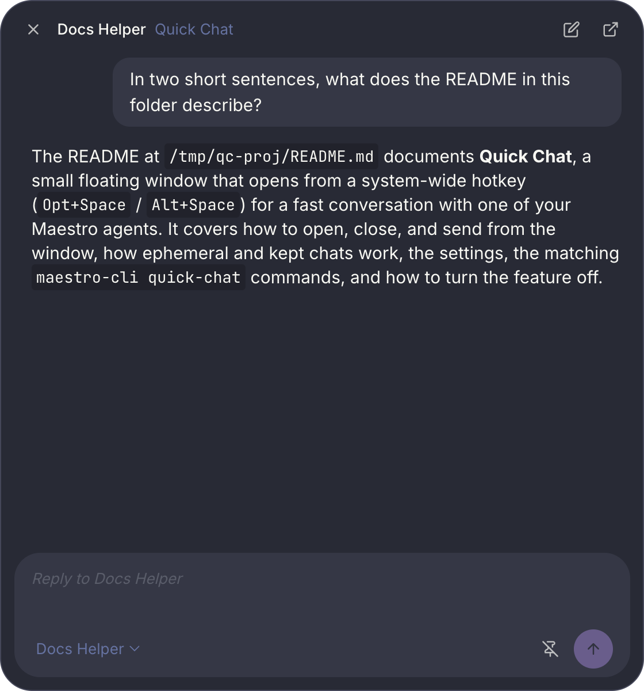

Quick Chat is a small floating window for a fast conversation with one agent. Press the hotkey from any app, type, read the answer, and press the hotkey again to put it away. You never switch to the main Maestro window.



Quick Chat is an [Encore Feature](/encore-features), on by default. It ships as the first-party **Quick Chat** plugin.

## Opening and closing it

| Action                                       | How                                                                                                                                                                                         |
| -------------------------------------------- | ------------------------------------------------------------------------------------------------------------------------------------------------------------------------------------------- |
| Open, focus, or close the window             | `Opt+Space` (macOS) / `Alt+Space` (Windows, Linux), from any app                                                                                                                            |
| Open it from inside Maestro                  | **Open Quick Chat** in the command palette, **Quick Chat** in the Left Bar hamburger menu, or `maestro-cli open quick-chat`                                                                 |
| Close it                                     | `Esc`, or the **X** in the window                                                                                                                                                           |
| Start a new chat                             | `Cmd+N` / `Ctrl+N`, or the pencil in the window                                                                                                                                             |
| Switch agent                                 | Click the agent name at the top left, or `Cmd+K` / `Ctrl+K`. Type to filter, then `Enter`                                                                                                   |
| Send                                         | `Enter` (`Shift+Enter` for a new line)                                                                                                                                                      |
| Open the chat in Maestro                     | `Cmd+T` / `Ctrl+T`, or the arrow in the window. The chat becomes a visible tab and Maestro comes forward                                                                                    |
| View a diagram full screen                   | The expand button on a diagram or image. The window fills its screen until you press `Esc`                                                                                                  |
| Make the conversation text bigger or smaller | `Cmd+=` / `Cmd+-` (`Ctrl` on Windows and Linux), or the A buttons at the bottom left. `Cmd+0` resets. Maestro remembers the size across restarts, and `maestro-cli quick-chat font` sets it |
| Keep the chat as a tab                       | `Cmd+B` / `Ctrl+B`, or the bookmark in the window. Press again to make it temporary                                                                                                         |
| Pin the window on top                        | `Cmd+P` / `Ctrl+P`, or the pin in the window. Press again to unpin                                                                                                                          |

The hotkey toggles: when the window is closed it opens; when it is open but behind another window it comes to the front; when it is in front it closes. Closing the window keeps the conversation, so the next press brings you back where you were.

The window shows on every desktop, including over full-screen apps. While the pin in the window is on (the default, toggled with `Cmd+P` / `Ctrl+P`), it floats above other apps. Turn the pin off and it behaves like an ordinary window: it falls behind whatever you click next, and the hotkey still brings it to the front. Maestro remembers the pin across restarts.

Drag the grip at the top of the window (or the header, once a conversation is showing) to move it, and drag an edge or corner to resize it. Maestro remembers the size and the spot across restarts. Until you move the window yourself, it opens centered on the screen under your pointer.

Before your first message the window is just the composer, so only its width changes. Once a conversation is showing, you can make it taller or shorter too, and that height is kept for the next conversation. If the screen the window was on is no longer connected, it opens on your main screen instead.

## Where the conversation lives

Every Quick Chat is a real AI tab on the agent you choose. It uses that agent's provider, model, working directory, SSH remote, and permissions, exactly like a tab you open yourself. The agent can be busy in another tab: your quick chat does not wait for it.

A chat has one of two modes, and you can flip between them at any time with the bookmark in the window or `Cmd+B` / `Ctrl+B`:

| Mode                | What happens                                                                                                                                                |
| ------------------- | ----------------------------------------------------------------------------------------------------------------------------------------------------------- |
| Ephemeral (default) | The tab is hidden: no chip in the tab bar. When you start a new chat, the tab is deleted. Whether its turns write [History](/history) entries is a setting. |
| Kept (bookmark on)  | The tab is visible on the agent like any other and stays there after you start the next chat.                                                               |

A reply never raises a completion toast in the main window: you are reading it in Quick Chat. The audio or spoken notification you configured still plays.

## Settings

Open **Settings -> Plugins**, select **Quick Chat**, and open its **Settings** tab.

- **Hotkey.** Click the button and press a new combo. Leave it blank to turn the hotkey off. If another app or Maestro hotkey already holds the combo, Maestro shows a warning and the hotkey stays off until you pick another one.
- **Agent.** The agent every new chat talks to. "The agent active in the main window" follows whatever agent you last selected. You can also switch agents from the window itself: click the agent name at the top left (or press `Cmd+K` / `Ctrl+K`), type a few letters of the agent's name, group, or provider, and press `Enter`. Switching starts a new chat on that agent and saves the choice; picking the agent you are already on keeps the chat. A chat in progress stays on its agent even if you change this setting.
- **Keep new chats as tabs.** The default mode for a new chat.
- **Record ephemeral chats in History.** On by default, so an ephemeral chat still leaves a History entry after its tab is gone. Kept chats follow your normal history setting.

<Note>
On Windows, `Alt+Space` normally opens a window's system menu. While Quick Chat holds the combo, it opens Quick Chat instead. Pick a different hotkey if you rely on that menu.
</Note>

## From the command line

Every button in the window has a `maestro-cli quick-chat` verb that takes the same path:

```bash
maestro-cli quick-chat toggle              # exactly what the hotkey does
maestro-cli quick-chat show
maestro-cli quick-chat hide
maestro-cli quick-chat send "what does this error mean?"
maestro-cli quick-chat status              # window, agent, mode, and the conversation (--json for scripts)
maestro-cli quick-chat new
maestro-cli quick-chat keep                # keep the current chat as a tab ("keep off" makes it ephemeral)
maestro-cli quick-chat pin                 # float the window above other windows ("pin off" lets it fall behind)
maestro-cli quick-chat font in             # bigger conversation text: in, out, reset, or a size such as 120%
maestro-cli quick-chat agent <agent-id>    # switch agents and start a new chat
maestro-cli quick-chat reveal              # open the chat as a tab in Maestro
maestro-cli quick-chat stop                # stop the reply
maestro-cli quick-chat bounds --x 200 --y 120 --width 640 --height 520   # move or resize, as dragging does
```

`bounds` takes any of the four flags (`--x` and `--y` together). `--height` is the conversation height, so before the first message it is remembered rather than applied. `quick-chat status` reports the current size and spot.

The settings live in `quickChatSettings` (`hotkey`, `agentId`, `persistent`, `ephemeralHistory`), readable and writable with `maestro-cli settings get` / `settings set`. Turn the feature off or on with `maestro-cli encore disable quickChat` / `encore enable quickChat`.

## Turning it off

Disabling Quick Chat releases the hotkey and closes the window. Chats you kept as tabs stay on their agents.
